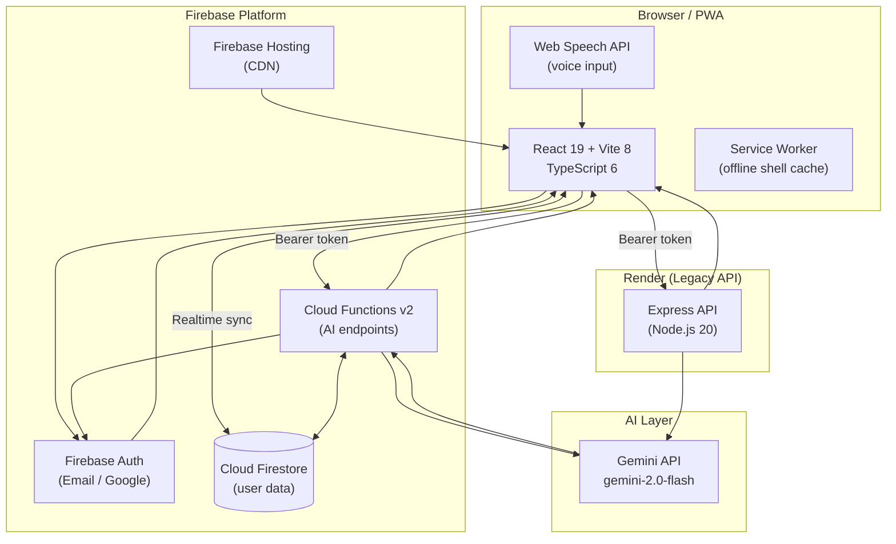

# Financial Observatory

<div align="center">


**A production-grade AI-powered personal finance platform.**

[Live App](https://financial-observatory-1b20e.web.app) · [GitHub](https://github.com/tanmayyyyayyy/FINANCIAL-OBSERVATORY) · [API Health](https://smart-expense-tracker-q1sh.onrender.com/health)

</div>

---

## What Is This?

Financial Observatory is a full-stack, production-deployed personal finance application. It answers the three questions that matter in personal finance:

- **Where did my money go?** — categorized transaction ledger, spending charts, category breakdowns
- **Am I on track?** — real-time budget safeguards with visual progress meters
- **What comes next?** — predictive spend forecasting and savings goal planning

Built to demonstrate production-quality engineering: authenticated users, real Firestore data, server-side AI with API key security, PWA installation, voice input, receipt scanning, PDF statement import, deep-link shortcuts, and a design system that respects accessibility and reduced-motion preferences.

---

## Live Deployments

| Service | URL | Stack |
|---|---|---|
| **Frontend** | https://financial-observatory-1b20e.web.app | Firebase Hosting |
| **Backend API** | https://smart-expense-tracker-q1sh.onrender.com | Render (Node/Express) |
| **AI Functions** | Firebase Cloud Functions v2 | Node.js 20 |
| **Health Check** | `GET /health` → `{"ok":true}` | No auth required |

---

## Feature Highlights

### 🏠 Unified Command-Center Dashboard

Everything visible, nothing hidden behind navigation. The dashboard is a single, scrollable command center:

- **Primary Financial Metrics Rail** — Money In / Money Out / Money Left / Saved — computed deterministically from transactions and income profile with MoM delta badges
- **Quick Action Dock** — 6 instant actions (+ Expense, + Income, 🎙 Voice, ⚡ 5-Sec Add, 💬 Ask AI, 📱 Phone Shortcut) available without any navigation
- **Spending Chart** — 30-day daily spending series with interactive hover tooltips
- **Category Breakdown** — Pie chart allocation across all spending categories
- **Category Budgets Hub** — Budget limits, progress bars, status badges (Exceeded / Near / On Track), and inline limit editing without leaving the dashboard
- **Savings Goal Planner** — AI-assisted goal drafting and progress tracking, embedded directly on the dashboard
- **Weekly Money Check-In** — Spending alerts, budget reminders, unusual charge detection, and duplicate transaction flags
- **Active Subscriptions & Recurring Charges** — Auto-detected recurring patterns surfaced as a card
- **Month-End Spending Estimate** — Forward-looking burn rate projection with daily velocity and category concentration
- **Recent Activity Feed** — Last 5 transactions in a responsive table (desktop) / card list (mobile)
- **New User Orientation Banner** — Dismissible 3-step jumpstart guide for first-time users
- **Mobile Shortcuts Promo Card** — One-click setup guide for iOS and Android phone shortcuts

### ⚡ Quick Add PWA — 5-Second Expense Capture

An installable, mobile-first standalone PWA designed for real-world use on the go:

- **Numeric keypad autofocus** — start typing amount the instant the page loads
- **48px touch target categories** — single-tap category selection
- **Quick Presets** — ₹100 Coffee / ₹200 Travel / ₹500 Food in one tap
- **Voice input** — speak "₹200 coffee" and the parser fills the form (see Voice Entry below)
- **Inline confirmation** — success banner appears without navigating away; ready for next entry immediately
- **Offline detection** — shows a banner when connectivity is lost and blocks save until reconnected
- **Phone Shortcut setup** — step-by-step iOS / Android shortcut guide accessible from the form header

### 📱 Mobile Shortcuts — iOS & Android

Native-grade phone shortcuts to open the app in one physical gesture:

**iOS — Physical Double-Tap:**
1. Copy your Quick Add URL from the app
2. Create a shortcut in Apple's Shortcuts app → "Open URLs"
3. Settings → Accessibility → Touch → Back Tap → Double Tap → assign the shortcut
4. Double-tap the back of your iPhone from anywhere to log an expense

**Android — Home Screen Shortcut:**
1. In Chrome, tap ⋮ → "Add to Home Screen" / "Install App"
2. Long-press the installed icon to reveal deep-link shortcuts:
   - ⚡ Quick Add (5-sec expense form)
   - 🎙 Voice Expense
   - 💬 Ask AI
   - 📊 Dashboard

**PWA Manifest shortcuts** (`manifest.webmanifest`) expose 4 deep-link targets that Android surfaces as icon shortcuts automatically after installation.

**URL action parameters** — deep links like `/dashboard?action=voice` or `/dashboard?action=ask` open the appropriate modal directly, usable from shortcuts, widgets, or NFC tags.

### 🎙 Voice Expense Entry

Full Web Speech API integration for hands-free expense logging:

- Tap the microphone → speak the expense naturally ("Paid ₹450 at Swiggy for dinner")
- On-device speech recognition → client-side NLP parser extracts amount, category, merchant, and payment method
- Review screen shows parsed fields before saving — no AI required for basic voice entry
- Handles permission denial, unsupported browsers, and recognition errors gracefully
- Available from the dashboard, Quick Add, and the command palette

### 🤖 AI Financial Assistant — Ask Your Money

A conversational panel backed by Gemini through Firebase Cloud Functions:

- **Natural language queries** — "How much did I spend on food last week?" / "Am I close to my entertainment budget?"
- **Server-side financial data tools** — the AI calls Firestore via the backend before answering (spending summaries, budget status, category trends, recent transactions)
- **Multi-turn conversation** — up to 8 turns per session with conversation history
- **Natural-language transaction entry** — "Add ₹1,200 rent for October" → AI parses and presents a draft for confirmation; never saves without user approval
- **Receipt scanning** — upload a photo of any receipt; AI extracts merchant, amount, date, and category
- **Savings goal creation** — describe a goal in plain text; AI parses name, amount, and target date
- **Weekly spending insight** — AI summarizes the week's spending pattern with suggestions
- **Opt-in by default** — disabled until the user explicitly enables it in Settings
- **Zero direct data mutation** — AI output always goes through a confirmation step; never writes to Firestore autonomously

### 📊 Transaction Ledger

- Full searchable and filterable transaction history
- Edit and delete any transaction inline
- Income / expense type distinction with visual color coding
- Category pills, payment method tags, and date display
- Duplicate detection and unusual charge flags surfaced on the dashboard
- Sample data mode — one click to populate with realistic data for exploration

### 💰 Budgets

- Set per-category monthly spending limits
- Real-time progress bars (spent vs. limit with percentage)
- Status indicators: On Track / Approaching (≥80%) / Exceeded
- Budget-aware alerts surfaced on the dashboard weekly check-in
- Inline limit editing from the dashboard — no navigation required
- Direct link to full budget management page

### 📈 Spending Prediction

- Month-end spending projection based on daily velocity
- Under/over budget verdict with exact surplus or deficit amount
- Daily spend average and top category concentration cards
- Full Prediction Engine page with historical trend visualization and savings forecasting

### 🎯 Savings Goal Planner

- AI-assisted or manual goal creation
- Auto-computes required monthly savings amount from target amount and date
- Progress tracking with visual progress bars
- Stored per-user in Firestore with real-time sync
- Embedded directly on the main dashboard

### 📄 Statement Import

- Upload any bank or UPI statement as a PDF
- PDF.js extracts raw text client-side
- AI parses transactions from extracted text
- Each parsed transaction is shown for individual confirmation before saving
- Supported formats: major Indian bank and UPI statement PDFs

### ⌨️ Command Palette

Global keyboard shortcut `⌘K` / `Ctrl+K` opens a searchable command palette:
- Jump to any page
- Open Quick Add (expense or income)
- Launch Ask Your Money
- Toggle Privacy Mode

### 🔒 Privacy Shield

- Toggle privacy mode from the navbar or command palette
- Blurs all financial figures (balances, amounts) against shoulder surfing
- Multitasking screen blur — automatically blurs the app when it's backgrounded on mobile
- 30-minute idle timeout with automatic sign-out

### ♿ Accessibility

- Keyboard-navigable throughout
- ARIA labels on all interactive controls
- Visible focus states
- `prefers-reduced-motion` support on all animations
- Skip-to-main-content link
- Role and aria-live regions on toast notifications

---

## Financial Calculation Model

All calculations follow a single, deterministic, transparent model:

```
Money In    = Profile monthly income + Σ income transactions (current month)
Money Out   = Σ expense transactions (current month)
Money Left  = Money In − Money Out
Saved (%)   = Money Left / Money In × 100

Projected   = (Money Out / days elapsed) × total days in month
```

- Legacy transactions without a `type` field are treated as expenses (backward compatible)
- Savings rate comparison uses MoM period-to-date to avoid misleading partial-month comparisons
- AI is never used for arithmetic — all financial calculations are deterministic application code

---

## AI Architecture & Security

All AI interaction routes through Firebase Cloud Functions. The Gemini API key never reaches the browser.

```
Browser (React SPA)
  │
  ├── Firebase Auth (Email / Google)
  │     └── Firebase ID Token (JWT, short-lived)
  │
  └── POST /api/ai/* ─→ Firebase Cloud Functions v2 (Node.js 20)
            │
            ├── Firebase Admin SDK — verifies ID token, extracts UID
            │
            ├── AI opt-in check (Firestore: users/{uid}/preferences)
            │
            ├── Server-side per-user rate limiter (in-memory, burst + daily cap)
            │
            ├── Firestore — reads user's financial data for context
            │
            ├── Gemini API (gemini-2.0-flash) — structured JSON output
            │
            └── JSON schema validation → Validated response → Browser
```

**Security properties:**
- Gemini API key stored as Firebase Functions secret — never committed, never sent to client
- Every AI endpoint validates a Firebase ID token — no anonymous AI access
- Backend derives UID from verified token — no client-supplied UID is trusted
- AI is opt-in per user account; disabled by default
- AI output is validated against strict JSON schemas before returning
- AI never directly mutates Firestore — all results require explicit user confirmation
- Firestore security rules enforce `users/{uid}/` scoping — users cannot access each other's data

---

## Tech Stack

| Layer | Technology | Version |
|---|---|---|
| **Frontend framework** | React | 19 |
| **Language** | TypeScript | 6 |
| **Build tool** | Vite | 8 |
| **Styling** | Tailwind CSS (`@tailwindcss/vite`) | 4 |
| **Styling** | Custom CSS design tokens | — |
| **Routing** | React Router | 7 |
| **Charts** | Recharts | 3 |
| **Animation** | Framer Motion | 13 |
| **Icons** | Lucide React | latest |
| **PDF parsing** | PDF.js (pdfjs-dist) | 6 |
| **Backend runtime** | Node.js | 20 |
| **Backend framework** | Express | 4 |
| **Serverless functions** | Firebase Cloud Functions v2 | — |
| **Authentication** | Firebase Authentication | — |
| **Database** | Cloud Firestore | — |
| **Admin SDK** | Firebase Admin | 13 |
| **AI model** | Google Gemini | gemini-2.0-flash |
| **Hosting** | Firebase Hosting | — |
| **API Hosting** | Render | — |
| **PWA** | Web App Manifest + Service Worker | — |
| **Speech** | Web Speech API | native |

---

## Architecture Overview



---

## Project Structure

```
Financial-Observatory/
├── app/                              # React/Vite Frontend (Firebase Hosting)
│   ├── public/
│   │   ├── manifest.webmanifest      # PWA manifest with 4 deep-link shortcuts
│   │   ├── sw.js                     # Service worker (offline shell cache)
│   │   └── icons/                    # PWA icon set (192, 512, maskable, apple-touch)
│   └── src/
│       ├── pages/                    # Route-level components
│       │   ├── Dashboard.tsx         # Unified command-center (metrics, budgets, goals, shortcuts)
│       │   ├── QuickAdd.tsx          # Standalone PWA expense form
│       │   ├── Budgets.tsx           # Full budget management
│       │   ├── Ledger.tsx            # Transaction history with search/filter
│       │   ├── Prediction.tsx        # Spend forecast + goal planner
│       │   ├── Settings.tsx          # Account, AI toggle, statement import
│       │   ├── Onboarding.tsx        # Income + budget profile setup
│       │   ├── Landing.tsx           # Marketing landing page
│       │   ├── Login.tsx / Signup.tsx
│       │   └── TransactionSuccess.tsx
│       ├── components/               # Shared UI components
│       │   ├── AskYourMoney.tsx      # AI chat panel
│       │   ├── VoiceExpenseModal.tsx # Voice entry with Web Speech API
│       │   ├── DashboardBudgets.tsx  # Inline budget widget for dashboard ✨ NEW
│       │   ├── MobileShortcutModal.tsx # iOS/Android shortcut setup guide ✨ NEW
│       │   ├── QuickAddModal.tsx     # Global quick-add overlay
│       │   ├── CommandPalette.tsx    # ⌘K command palette
│       │   ├── GoalPlanner.tsx       # AI savings goal tool
│       │   ├── StatementImport.tsx   # PDF statement parser
│       │   ├── SpendingChart.tsx     # 30-day spending line chart
│       │   ├── CategoryBreakdown.tsx # Category pie chart
│       │   ├── MetricCard.tsx        # Financial metric display card
│       │   ├── AuthShell.tsx         # Split-screen auth layout
│       │   ├── PwaInstallPrompt.tsx  # Android install banner
│       │   ├── Navbar.tsx            # Top navigation bar
│       │   └── ui/                   # UI primitive library
│       │       ├── animated-number.tsx
│       │       ├── animated-button.tsx
│       │       ├── border-beam.tsx
│       │       ├── glow-border-card.tsx
│       │       └── skiper-ui / animmaster/
│       ├── context/                  # React context providers
│       │   ├── AuthContext.tsx
│       │   ├── TransactionsContext.tsx
│       │   ├── BudgetsContext.tsx
│       │   ├── FinancialProfileContext.tsx
│       │   └── AiPreferencesContext.tsx
│       ├── firebase/                 # Firebase SDK + AI client
│       │   ├── firebase.ts           # App initialization
│       │   ├── ai.ts                 # Cloud Functions call wrappers
│       │   └── errors.ts             # Error message normalization
│       └── utils/                    # Pure utility functions
│           ├── analytics.ts          # Financial computation (deterministic)
│           ├── insights.ts           # Signal detection (alerts, duplicates, recurring)
│           ├── formatters.ts         # Currency, date formatters
│           ├── voiceParser.ts        # Client-side NLP for voice input
│           ├── usePwaInstall.ts      # beforeinstallprompt hook
│           ├── useIdleTimeout.ts     # 30-min idle logout
│           └── usePrivacyShield.ts   # Privacy blur mode
│
├── functions/                        # Firebase Cloud Functions v2 (AI backend)
│   └── src/
│       ├── ai/
│       │   ├── index.ts              # Cloud Functions entry (callable + HTTP)
│       │   ├── gemini.ts             # Gemini REST client
│       │   ├── features.ts           # AI feature handlers
│       │   ├── schemas.ts            # JSON output schemas & validators
│       │   └── security.ts           # Auth + AI opt-in + rate limit middleware
│       └── index.ts                  # Functions root export
│
├── server/                           # Legacy Render Express API
│   └── src/
│       ├── ai/                       # Express AI route handlers
│       ├── routes/ai.ts              # /api/ai/* router
│       ├── firebase.ts               # Firebase Admin init
│       └── index.ts                  # Express entry point
│
├── firestore.rules                   # Firestore security rules (user-scoped)
├── firebase.json                     # Firebase Hosting + Functions config
├── render.yaml                       # Render infrastructure definition
└── docs/                             # Product documentation
```

---

## Design System

The interface follows an **Apple × Linear × Raycast** direction — premium, focused, and typographically precise.

| Token | Value |
|---|---|
| **Base background** | `#040405` (near-black) |
| **Surface levels** | `#0a0a0b` / `#0e0e10` / `#141416` / `#1a1a1d` |
| **Primary accent** | `rgba(99, 102, 241, ...)` (indigo) |
| **Positive** | `#10b981` (emerald) |
| **Negative** | `#f43f5e` (rose) |
| **Warning** | `#f59e0b` (amber) |
| **Typography** | Inter (variable, 14–32px optical range) |
| **Monospace** | SFMono / Menlo (financial figures) |
| **Easing** | `cubic-bezier(0.22, 1, 0.36, 1)` (Apple spring) |

Key design decisions:
- **Glass surfaces** — `rgba(255, 255, 255, 0.012–0.035)` with `1px` subtle borders
- **Tabular numerals** — all financial amounts rendered with `font-variant-numeric: tabular-nums` so digits align in columns
- **Restrained motion** — entrance animations max 250ms, all gated by `prefers-reduced-motion`
- **CSS custom properties** — full design token system (`--surface-*`, `--border-*`, `--accent-*`, `--radius-*`, `--ease-*`)

---

## Local Development

### Prerequisites

- Node.js 20+
- A Firebase project with Authentication, Firestore, and Functions enabled
- A Google Gemini API key
- Firebase CLI (`npm install -g firebase-tools`)

### 1. Clone

```bash
git clone https://github.com/tanmayyyyayyy/FINANCIAL-OBSERVATORY.git
cd FINANCIAL-OBSERVATORY
```

### 2. Frontend

```bash
cd app
cp .env.example .env          # fill in VITE_FIREBASE_* keys
npm install
npm run dev                   # http://localhost:5173
```

### 3. Firebase Functions (AI backend)

```bash
cd functions
npm install
npm run build

# To run functions locally with emulators:
firebase emulators:start --only functions
```

### 4. Legacy Express API (optional)

```bash
cd server
cp .env.example .env          # fill in GEMINI_API_KEY and FIREBASE_SERVICE_ACCOUNT_JSON
npm install
npm run dev                   # http://localhost:5001
```

### Environment Variables

**`app/.env`**

```
VITE_FIREBASE_API_KEY=
VITE_FIREBASE_AUTH_DOMAIN=
VITE_FIREBASE_PROJECT_ID=
VITE_FIREBASE_STORAGE_BUCKET=
VITE_FIREBASE_MESSAGING_SENDER_ID=
VITE_FIREBASE_APP_ID=
VITE_API_BASE_URL=http://localhost:5001
```

**Firebase Functions secrets** (set via `firebase functions:secrets:set`):

```
GEMINI_API_KEY
```

> ⚠️ Never commit `.env` files, service account JSON, or API keys.

---

## API Reference

### Firebase Cloud Functions (primary AI layer)

All callable functions require Firebase Authentication.

| Function | Type | Description |
|---|---|---|
| `parseTransactionText` | Callable | Parse natural-language transaction to structured fields |
| `scanReceipt` | Callable | Extract transaction data from a receipt image (base64) |
| `parseSavingsGoal` | Callable | Parse a savings goal from plain text |
| `generateWeeklyInsight` | Callable | AI summary of the week's spending pattern |
| `askYourMoney` | Callable | Multi-turn conversational financial assistant |

### Legacy Express API (Render)

| Method | Path | Auth | Description |
|---|---|---|---|
| `GET` | `/health` | None | Liveness probe |
| `POST` | `/api/ai/parse-transaction` | Firebase ID Token | Parse transaction text |
| `POST` | `/api/ai/scan-receipt` | Firebase ID Token | Scan receipt image |
| `POST` | `/api/ai/parse-goal` | Firebase ID Token | Parse savings goal |
| `POST` | `/api/ai/weekly-insight` | Firebase ID Token | Weekly insight summary |
| `POST` | `/api/ai/ask` | Firebase ID Token | Ask Your Money conversation |

---

## PWA & Mobile Shortcut Technical Details

### Service Worker (`sw.js`)

- Network-first strategy for all requests
- Falls back to cache for static shell assets (HTML, CSS, JS, icons)
- **Never caches** Firebase auth, Firestore, or any private API calls
- App shell assets cached on install: `/`, `/manifest.webmanifest`, `/favicon.svg`, icons

### Web App Manifest (`manifest.webmanifest`)

```json
{
  "display": "standalone",
  "start_url": "/dashboard",
  "shortcuts": [
    { "name": "Quick Add Expense", "url": "/quick-add" },
    { "name": "Voice Entry",       "url": "/dashboard?action=voice" },
    { "name": "Ask AI",            "url": "/dashboard?action=ask" },
    { "name": "Main Dashboard",    "url": "/dashboard" }
  ]
}
```

### URL Action Deep Links

| URL | Effect |
|---|---|
| `/dashboard?action=voice` | Opens voice expense modal immediately |
| `/dashboard?action=ask` | Opens Ask Your Money AI panel |
| `/dashboard?action=quickadd` | Opens Quick Add expense modal |
| `/dashboard?action=income` | Opens Quick Add income modal |
| `/dashboard?action=shortcuts` | Opens mobile shortcuts setup guide |
| `/quick-add?voice=1` | Opens Quick Add with voice modal active |

---

## Deployment

### Firebase Hosting (Frontend)

```bash
cd app && npm run build
firebase deploy --only hosting
```

### Firebase Functions (AI Backend)

```bash
cd functions && npm run build
firebase deploy --only functions
```

### Render (Legacy Express API)

Deploys automatically on push to `main` via `render.yaml`. Two services:
- **Static site** — `app/` directory, SPA rewrite fallback to `index.html`
- **Web service** — `server/` directory, TypeScript compiled to `dist/`, started with `node dist/index.js`

---

## Firestore Security Rules

```
users/{uid}/transactions   — read/write only by authenticated user with matching UID
users/{uid}/budgets        — read/write only by authenticated user with matching UID
users/{uid}/categories     — read/write only by authenticated user with matching UID
users/{uid}/goals          — read/write only by authenticated user with matching UID
users/{uid}/preferences    — read/write only by authenticated user with matching UID
```

Firestore rules are version-controlled in [`firestore.rules`](firestore.rules). The Cloud Functions backend reads user data via Firebase Admin SDK, which bypasses client-facing security rules but still operates within the server's own authentication layer — no data is ever returned without a verified token.

---

## Security Headers (Firebase Hosting)

All responses include production-grade security headers via `firebase.json`:

| Header | Value |
|---|---|
| `X-Content-Type-Options` | `nosniff` |
| `X-Frame-Options` | `DENY` |
| `Referrer-Policy` | `strict-origin-when-cross-origin` |
| `Strict-Transport-Security` | `max-age=63072000; includeSubDomains; preload` |
| `Content-Security-Policy` | Strict allowlist (self + Firebase + Google Fonts) |
| `Permissions-Policy` | `geolocation=(), camera=(self), microphone=(self)` |
| `Cache-Control` | `public, max-age=31536000, immutable` for hashed assets |

---

## Contributing

See [CONTRIBUTING.md](CONTRIBUTING.md) for development guidelines, commit conventions, and pull request process.

---

## License

This project is for portfolio and educational purposes. All financial calculations and data remain private and user-scoped. Financial Observatory does not constitute financial advice.

---

<div align="center">

Built with React 19, TypeScript 6, Firebase, and Gemini AI.

[Live App](https://financial-observatory-1b20e.web.app) · [Repository](https://github.com/tanmayyyyayyy/FINANCIAL-OBSERVATORY)

</div>
